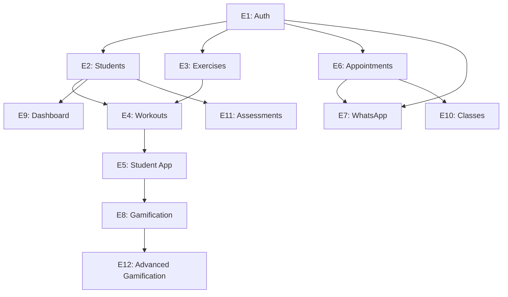

# PRD - Indice de Epicos

## FIS360 - Plataforma Inteligente de Gestao Fitness

---

## Fase 1 - MVP (Q1-Q2 2026)

| Epic | Nome | Prioridade | Complexidade | Arquivo |
|------|------|------------|--------------|---------|
| E1 | Autenticacao e Multi-tenancy | Must Have | Alta | [epic-1-auth.md](./epic-1-auth.md) |
| E2 | Gestao de Alunos | Must Have | Media | [epic-2-students.md](./epic-2-students.md) |
| E3 | Biblioteca de Exercicios | Must Have | Media | [epic-3-exercises.md](./epic-3-exercises.md) |
| E4 | Prescricao de Treinos | Must Have | Alta | [epic-4-workouts.md](./epic-4-workouts.md) |
| E5 | App do Aluno | Must Have | Alta | [epic-5-student-app.md](./epic-5-student-app.md) |
| E6 | Agenda e Agendamentos | Must Have | Media | [epic-6-appointments.md](./epic-6-appointments.md) |
| E7 | Integracao WhatsApp | Must Have | Media | [epic-7-whatsapp.md](./epic-7-whatsapp.md) |
| E8 | Gamificacao Basica | Should Have | Media | [epic-8-gamification.md](./epic-8-gamification.md) |
| E9 | Dashboard e Metricas | Should Have | Media | [epic-9-dashboard.md](./epic-9-dashboard.md) |

---

## Fase 2 - Studios (Q3-Q4 2026)

| Epic | Nome | Prioridade | Complexidade | Arquivo |
|------|------|------------|--------------|---------|
| E10 | Aulas Coletivas | Must Have | Media | [epic-10-classes.md](./epic-10-classes.md) |
| E11 | Avaliacoes Fisicas | Must Have | Media | [epic-11-assessments.md](./epic-11-assessments.md) |
| E12 | Gamificacao Avancada | Should Have | Alta | [epic-12-advanced-gamification.md](./epic-12-advanced-gamification.md) |
| E13 | Comunidade e Feed | Could Have | Media | (planejado) |
| E14 | Financeiro Basico | Should Have | Alta | (planejado) |

---

## Fases Futuras

### Fase 3 - Academias (2027 H1)
- Integracao com catracas
- Gestao financeira completa
- Multi-unidades

### Fase 4 - Fisioterapia (2027 H2)
- Prontuario digital
- Protocolos de tratamento
- Laudos automaticos

### Fase 5 - Ecossistema (2028)
- Marketplace de programas
- API publica
- White-label

---

## Ordem de Implementacao Sugerida

---

## Legenda de Prioridade

- **Must Have**: Essencial para MVP
- **Should Have**: Importante, incluir se possivel
- **Could Have**: Desejavel, pode ser adiado
- **Won't Have**: Fora do escopo atual

---

*Referencia: docs/prd.md*
